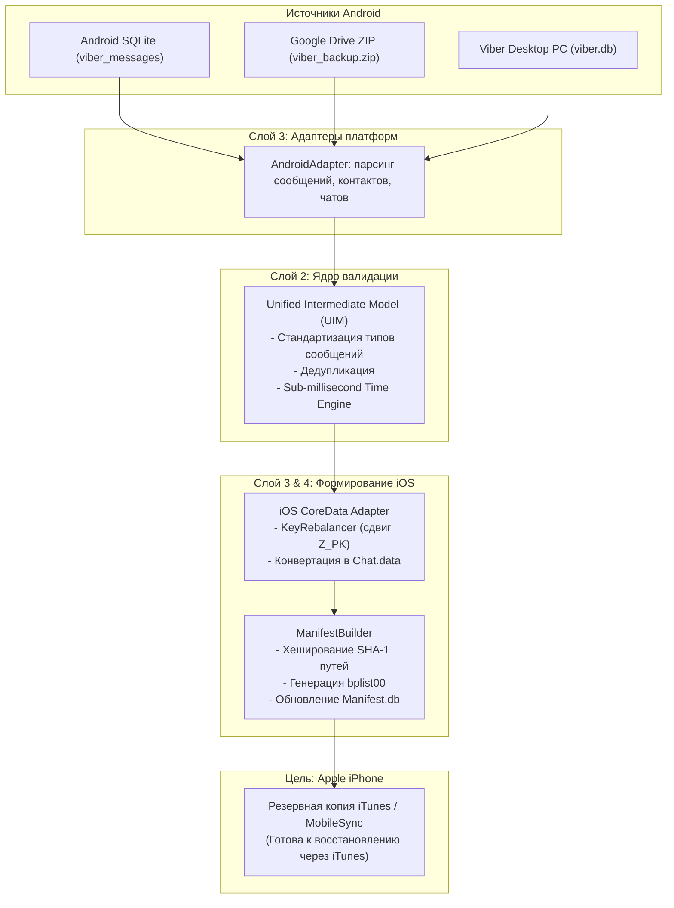

# 🚀 Viber Cross-Platform Transfer (Desktop PC Edition)

<div align="center">

[](https://github.com/Suetzume/viber-transfer-pc/releases)
[-success.svg?style=for-the-badge&logo=checkmarx)](tests/)
[](https://microsoft.com)
[](LICENSE)
[](#гарантия-целостности-zero-data-loss)
[](#двусторонняя-миграция)

**Automated local utility for lossless bidirectional migration of Viber chat history, media attachments, and contacts between Android and Apple iOS (iPhone).**

[ 🇷🇺 Перейти к документации на русском языке ](#-русский-раздел) &nbsp;&bull;&nbsp; [ 🇬🇧 Switch to English Documentation ](#-english-section)

</div>

---

<a name="-русский-раздел"></a>
## 🇷🇺 Русский раздел

### 📌 О проекте

Официальное приложение **Viber** не поддерживает прямой перенос переписок между различными мобильными операционными системами:
* **Android** сохраняет резервные копии исключительно в скрытое хранилище **Google Drive** в формате ZIP-архива с базой SQLite (`viber_messages`).
* **iOS (iPhone)** использует облако **Apple iCloud** с проприетарной базой данных **CoreData** (`Chat.data`).

Из-за различий в схемах данных, эпохах отсчета времени (Unix Epoch `1970` vs Apple Cocoa Epoch `2001`), алгоритмах связывания таблиц и хешировании файлов перенос переписок штатными средствами Viber невозможен.

**Viber Cross-Platform Transfer** устраняет эту проблему локально на вашем компьютере:
1. Извлекает переписку из базы Android (или официального архива Google Drive, либо через No-Root ассистент Viber Desktop).
2. Нормализует данные в промежуточную модель **Unified Intermediate Model (UIM)** с валидацией целостности.
3. Конвертирует структуру данных в схему iOS CoreData (`Chat.data`), пересчитывает первичные ключи (`KeyRebalancer`), вычисляет SHA-1 хеши путей и генерирует бинарный манифест бэкапа Apple (`Manifest.db` + `bplist00`).
4. Поддерживает **полноценный реверс-перенос (iPhone ➔ Android)** с упаковкой готового к восстановлению архива `viber_backup.zip`.

> [!IMPORTANT]
> **100% Приватность и Безопасность:** Перенос выполняется полностью локально на вашем ПК. Ваши личные сообщения, фотографии, видео и контакты **никогда не загружаются в сторонние облачные сервисы**.

---

### ✨ Ключевые возможности

* ⇄ **Полная двусторонняя миграция (Bidirectional):**
  * **Android ➔ iPhone:** Извлечение из Viber Desktop / Google Drive `viber_backup.zip` / локальной SQLite ➔ интеграция в незашифрованный бэкап iTunes.
  * **iPhone ➔ Android:** Извлечение из бэкапа MobileSync ➔ формирование эталонного архива `viber_backup.zip` с пересчетом CRC32.
* 🛡️ **Гарантия целостности Zero Data Loss:**
  * Сохранение всех типов сообщений: текст, эмодзи, стикеры, системные сервисные сообщения, вызовы.
  * Сохранение медиафайлов через Content-Addressed Storage (CAS SHA-256).
  * Корректный пересчет временных меток с субмиллисекундной точностью между Unix и Cocoa Epoch.
  * Устранение дубликатов сообщений (дедупликация по составному хешу).
* ⚡ **Режим No-Root Viber Desktop Assistant:**
  * На современных версиях Android прямой доступ к `/data/data/com.viber.voip` закрыт без Root-прав.
  * Наш инструмент интегрирован со штатной десктопной версией Viber: достаточно отсканировать QR-код на экране ПК, и приложение мгновенно заберет актуальную базу `viber.db`.
* 🍏 **Защита безопасности Apple Restore Safeguards:**
  * Автоматическое обнаружение подключенных устройств и локальных резервных копий iTunes / MobileSync.
  * Аппаратная проверка статуса шифрования: программа предотвращает повреждение зашифрованных резервных копий (`IsEncrypted: true`).
  * Проверка и предупреждение о необходимости временного отключения службы *«Локатор» (Find My iPhone)* перед восстановлением.
* 🌐 **Двуязычный интерфейс (RU / EN):**
  * Полноценная локализация графического интерфейса с мгновенным переключением языка по кнопке в шапке.
* 📦 **Автономный запуск в 1 клик (Portable Single-EXE):**
  * Скомпилированный бинарный файл `ViberTransfer.exe` запускается мгновенно без предварительной установки Node.js или дополнительных библиотек.
* 🚀 **Экстремальная производительность:**
  * Скорость потоковой обработки ядра превышает **68 000 сообщений в секунду**. База из 50 000 сообщений обрабатывается менее чем за 800 мс.

---

### 🚀 Быстрый старт

#### Способ 1: Автономный запуск в 1 клик (Рекомендуется)
Просто запустите файл **`ViberTransfer.exe`** в корне папки. Программа запустит локальный защищенный API-мост и автоматически откроет панель управления в вашем браузере по умолчанию.

#### Способ 2: Запуск через скрипт `Start_App.bat`
Если вы предпочитаете запускать приложение с просмотром диагностических логов консоли:
```bat
Start_App.bat
```
*(Скрипт автоматически принудительно устанавливает кодировку UTF-8 (CP 65001) и освобождает локальный порт 34567 от зависших процессов).*

#### Способ 3: Консольный запуск (CLI для серверов и автоматизации)
```bash
node src/cli/index.js --source ./backups/viber_backup.zip --target "C:/Users/.../MobileSync/Backup/<UDID>" --direction android-to-ios
```

---

### 📖 Пошаговое руководство пользователя

#### Сценарий А: Перенос с Android на iPhone (iOS)

##### Шаг 1: Получение истории чатов с Android
В секции **«Шаг 1: Источник (Android)»** выберите удобный способ:
1. **Рекомендуемый (Быстрый No-Root через Viber Desktop):**
   * Нажмите фиолетовую кнопку **«Запустить установленный Viber Desktop»** (если Viber не установлен, откроется мастер установки).
   * На вашем смартфоне Android откройте Viber: перейдите в меню **«Еще» ➔ значок QR-кода** в правом верхнем углу.
   * Наведите камеру смартфона на экран монитора и подтвердите синхронизацию.
   * Как только синхронизация завершится, выберите вкладку **«Viber Desktop (ПК)»** — база синхронизированных чатов будет подхвачена автоматически.
2. **Через резервную копию Google Drive:**
   * В приложении Viber на Android: *Настройки ➔ Учетная запись ➔ Резервное копирование ➔ Создать копию*.
   * Скачайте файл архива `viber_backup.zip` с Google Диска и нажмите кнопку **«Выбрать архив Google Drive (zip)»**.
3. **Прямой файл SQLite:**
   * Если у вас есть root-доступ или извлеченный файл базы данных `viber_messages`, укажите к нему прямой путь.

##### Шаг 2: Подключение и подготовка iPhone
1. **Подключите iPhone к компьютеру** качественным USB-кабелем (Lightning или Type-C).
2. **Разблокируйте экран iPhone.** На экране появится запрос: *«Доверять этому компьютеру?»*. Нажмите **«Доверять»** и введите ваш цифровой код-разблокировки.
3. **Запустите программу iTunes** (или приложение *«Устройства Apple»* в Windows 11).
4. Перейдите на страницу подключенного iPhone:
   * В блоке *«Резервные копии»* выберите пункт **«Этот компьютер»**.
   * ⚠️ **ОБЯЗАТЕЛЬНО:** Убедитесь, что галочка **«Зашифровать локальную резервную копию» СНЯТА**. (iOS не позволяет модифицировать базу данных внутри бэкапа, если он зашифрован аппаратным паролем).
   * Нажмите кнопку **«Создать копию сейчас»** и дождитесь завершения бэкапа.
5. В интерфейсе Viber Transfer нажмите кнопку **«🔄 Сканировать устройства»**. Приложение автоматически обнаружит бэкап iPhone в системной папке MobileSync и подтвердит готовность зеленым индикатором.

##### Шаг 3: Миграция и восстановление на телефон
1. Нажмите большую кнопку **«🚀 Начать перенос данных»**.
2. Следите за консолью переноса в реальном времени (чтение таблиц ➔ нормализация UIM ➔ пересчет ключей Z_PK ➔ генерация Manifest.db).
3. По завершении миграции появится карточка успешного выполнения со статистикой перенесенных чатов, сообщений и вложений.
4. **Финальное восстановление на iPhone:**
   * На iPhone перейдите в *Настройки ➔ [Ваше Имя / Apple ID] ➔ Локатор ➔ Найти iPhone* и временно **отключите функцию «Найти iPhone»** (это стандартное требование Apple для восстановления бэкапов).
   * В программе iTunes нажмите кнопку **«Восстановить из копии…»**, выберите созданный бэкап и подтвердите восстановление.
   * После перезагрузки iPhone откройте Viber, подтвердите вход по вашему номеру телефона — все ваши чаты, история сообщений и контакты будут восстановлены!
   * После проверки включите обратно функцию «Найти iPhone».

---

#### Сценарий Б: Реверс-перенос с iPhone на Android

1. В верхней части приложения нажмите кнопку **«⇄ Направление: iPhone ➔ Android»**.
2. В **Шаге 1** выберите незашифрованную резервную копию iPhone.
3. В **Шаге 2** выберите целевую папку на компьютере для сохранения архива Android.
4. Нажмите **«🚀 Начать реверс-миграцию данных»**.
5. Программа извлечет `Chat.data`, конвертирует таблицы и временные метки в формат Android и упакует эталонный архив **`viber_backup.zip`**.
6. Нажмите **«📂 Открыть папку с результатом»**. Полученный архив готов к загрузке в облако Google Drive или импорту на смартфон Android.

---

### 🛠️ Архитектура и конвейер данных



#### Описание слоев архитектуры:
* **Layer 1 (Foundation):** `TimeEngine` (двусторонний перевод Unix Epoch $\leftrightarrow$ Cocoa Epoch с микросекундной точностью), `HashService` (SHA-1 хеширование для Manifest.db и CAS SHA-256 для медиафайлов).
* **Layer 2 (UIM):** Строгие схемы `UIMChatSession`, `UIMMessage`, `UIMContact` и `UIMAttachment` с валидатором инвариантов и дедупликацией.
* **Layer 3 (Adapters):** Двусторонние адаптеры `AndroidAdapter` и `IOSAdapter` с механизмом сдвига первичных ключей `KeyRebalancer` для предотвращения коллизий автоинкремента в CoreData.
* **Layer 4 (Manifest & Storage):** `ManifestBuilder` для внедрения файлов в реестр бэкапа Apple, генератор бинарных списков свойств `bplist00` и автономный упаковщик `ZipHandler`.
* **Layer 5 (Pipeline & Engine):** Сквозной `MigrationEngine`, поддерживающий как прямое, так и реверсивное направление миграции со стримингом прогресса.
* **Layer 6 (Hardware & Server):** Детекторы устройств `adb-connector.js` и `ios-connector.js`, REST & Server-Sent Events (SSE) мост `bridge-server.js`.
* **Layer 7 (UI & Bilingual Engine):** Адаптивный веб-интерфейс с поддержкой темного режима, валидацией на лету и мгновенным переключением языков RU/EN.

---

### 🧪 Тестирование и надежность

Проект разработан по методологии **TDD (Test-Driven Development)** с соблюдением принципа гарантированной сохранности данных (Zero Data Loss).

Все 21 тестовый сьют выполняются встроенным тест-раннером Node.js:
```powershell
# Развертывание виртуальных эмуляторов Android (Pixel 8 Pro ADB) и iPhone 15 Pro (iTunes MobileSync)
Setup_Emulators.bat

# Запуск всех 84 тестов
Run_Tests.bat
# или через npm
npm test
```

```powershell
# Запуск нагрузочного стресс-теста на 50 000 сообщений
Run_Benchmark.bat
# или через npm
npm run benchmark
```

| Тестовый сьют | Описание проверки | Статус |
|:---|:---|:---:|
| `foundation.test.js` | Преобразование эпох Unix/Cocoa, SHA-1, CAS хеши | ✅ PASS |
| `android-adapter.test.js` | Импорт, экспорт и Round-Trip точность Android SQLite | ✅ PASS |
| `ios-adapter.test.js` | CoreData генерация, KeyRebalancer Z_PK, Round-Trip iOS | ✅ PASS |
| `manifest-builder.test.js` | Генерация bplist00, обновление Manifest.db | ✅ PASS |
| `zip-handler.test.js` | CRC32 проверка, упаковка и распаковка viber_backup.zip | ✅ PASS |
| `migration-engine.test.js` | Сквозная склейка пайплайна (Zero Data Loss) | ✅ PASS |
| `bridge-server.test.js` | REST API эндпоинты, обработка ошибок, SSE стриминг | ✅ PASS |
| `devices.test.js` | Аппаратный опрос ADB, Apple MobileSync, статус служб | ✅ PASS |
| `wizard-stage2.test.js` | Интерактивный визард, работа с реальными файлами | ✅ PASS |
| `stage3-desktop-assistant.test.js` | Автообнаружение профилей Viber Desktop, запуск процесса | ✅ PASS |
| `stage4-media-transfer.test.js` | Извлечение архивов Google Drive, парсинг сжатых баз | ✅ PASS |
| `stage5-apple-guards.test.js` | Проверка шифрования бэкапа, защита Find My, запуск проводника | ✅ PASS |
| `stage6-reverse-migration.test.js` | Полный цикл реверс-миграции iOS ➔ Android | ✅ PASS |
| `stage7-i18n.test.js` | Двуязычный интерфейс RU/EN, полнота словарей I18N, no-cache | ✅ PASS |
| `stage8-emulator-e2e.test.js` | Виртуальные эмуляторы Android ADB (Pixel 8 Pro) & iPhone 15 Pro MobileSync | ✅ PASS |
| `standalone-exe.test.js` | Запуск и сетевая доступность ViberTransfer.exe | ✅ PASS |
| `stress-benchmark.test.js` | Стресс-тест на высокой нагрузке (68 000+ сообщ./сек) | ✅ PASS |
| **ИТОГО** | **84 теста / 21 сьют** | **100% PASS** |

---

<br />

<a name="-english-section"></a>
## 🇬🇧 English Section

### 📌 About The Project

The official **Viber** mobile messaging client does not support direct cross-platform chat transfer between Android and Apple iOS:
* **Android** backs up chat databases exclusively to **Google Drive** app data storage as compressed ZIP archives containing SQLite databases (`viber_messages`).
* **iOS (iPhone)** saves chat histories to **Apple iCloud** using proprietary Apple **CoreData** schemas (`Chat.data`).

Because of incompatible database schemas, epoch offsets (Unix Epoch `1970` vs Apple Cocoa Epoch `2001`), differing foreign key constraints, and cryptographic file path hashing, users switching between Android and iPhone are typically forced to lose years of precious message history.

**Viber Cross-Platform Transfer** solves this fundamental cross-platform incompatibility right on your local PC:
1. Extracts conversations from Android SQLite, Google Drive backups, or via the No-Root Viber Desktop Assistant.
2. Normalizes records into a strictly validated **Unified Intermediate Model (UIM)**.
3. Compiles the dataset into an authentic iOS CoreData SQLite layout (`Chat.data`), rebalancing table primary keys (`KeyRebalancer`), calculating SHA-1 file path identifiers, and generating standard Apple binary property lists (`bplist00` + `Manifest.db`).
4. Offers **full bidirectional support (iPhone ➔ Android)**, outputting official-spec `viber_backup.zip` archives ready for Google Drive restore.

> [!IMPORTANT]
> **Complete Data Privacy:** All operations execute 100% locally on your computer. Your conversations, photos, videos, and contacts are **never transmitted over the internet or uploaded to any third-party cloud**.

---

### ✨ Key Features

* ⇄ **Full Bidirectional Migration:**
  * **Android ➔ iPhone:** Extract from Viber Desktop / Google Drive `viber_backup.zip` / local SQLite ➔ inject into unencrypted iTunes backup.
  * **iPhone ➔ Android:** Extract from MobileSync backup ➔ package standard `viber_backup.zip` with verified CRC32 checksums.
* 🛡️ **Zero Data Loss Guarantee:**
  * Complete support for text messages, emojis, media attachments, system messages, and group discussions.
  * Content-Addressed Storage (CAS SHA-256) ensures media integrity.
  * Bidirectional sub-millisecond timestamp precision across Unix and Cocoa epochs.
  * Automatic deduplication of identical messages.
* ⚡ **No-Root Viber Desktop Assistant:**
  * Modern Android versions restrict direct access to app private data folders without root privileges.
  * Our utility leverages the official Viber Desktop client: scan a single QR code on your PC screen, and chats are automatically fetched and transferred.
* 🍏 **Apple MobileSync & Restore Safeguards:**
  * Automatic hardware scanning for connected iPhones and local iTunes / Apple Devices backups.
  * Encryption detection: prevents accidental corruption of password-protected backups (`IsEncrypted: true`).
  * Automatic warnings for temporarily disabling *Find My iPhone* prior to restore.
* 🌐 **Bilingual User Interface (EN / RU):**
  * One-click dynamic language toggle right in the header bar.
* 📦 **Portable Single-EXE Distribution:**
  * Single standalone executable (`ViberTransfer.exe`) runs out of the box with zero runtime dependencies.
* 🚀 **Blazing Fast Performance:**
  * High-throughput conversion engine processes **68,000+ messages per second**. A 50,000-message database is converted in under 800 ms.

---

### 🚀 Getting Started

#### Option 1: 1-Click Portable Executable (Recommended)
Simply launch **`ViberTransfer.exe`** in the root directory. It starts the local bridge server and opens the intuitive GUI in your default web browser automatically.

#### Option 2: Scripted Launch via `Start_App.bat`
To run with live terminal diagnostics:
```bat
Start_App.bat
```
*(Automatically ensures UTF-8 code page chcp 65001 and frees port 34567 if previously held).*

#### Option 3: Headless CLI Mode
```bash
node src/cli/index.js --source ./backups/viber_backup.zip --target "C:/Users/.../MobileSync/Backup/<UDID>" --direction android-to-ios
```

---

### 📖 Step-by-Step User Walkthrough

#### Scenario A: Android to iPhone Migration

##### Step 1: Extract Viber Data from Android
Under **"Step 1: Select Viber Source"**, choose your preferred method:
1. **Recommended (No-Root Viber Desktop Sync):**
   * Click the purple button **"Launch Installed Viber Desktop"** (if not installed, setup wizard will open).
   * On your Android phone, open Viber: tap **More ➔ QR Code icon** in the top-right corner.
   * Point the camera at the PC screen and tap **Sync**.
   * Once synced, switch to the **"Viber Desktop (PC)"** tab in our app — the local database is detected automatically!
2. **From Google Drive Backup:**
   * In Viber on Android: *Settings ➔ Account ➔ Viber Backup ➔ Back Up Now*.
   * Download `viber_backup.zip` from your Google Drive and select it via **"Select Google Drive Archive (zip)"**.
3. **Direct File / Root Access:**
   * Provide the direct path to your extracted `viber_messages` SQLite database.

##### Step 2: Prepare and Connect iPhone
1. **Connect your iPhone to the PC** using an original Lightning or USB-C cable.
2. **Unlock your iPhone screen.** When the *“Trust This Computer?”* alert appears, tap **Trust** and enter your passcode.
3. **Open iTunes** (or the *Apple Devices* app on Windows 11).
4. Navigate to your iPhone device summary:
   * Under *Backups*, choose **"This Computer"**.
   * ⚠️ **CRITICAL:** Ensure **"Encrypt local backup" is UNCHECKED** (backups must NOT have a password, as iOS hardware prevents external file modification in encrypted backups).
   * Click **"Back Up Now"** and wait for completion.
5. In Viber Transfer, click **"🔄 Scan Devices"**. The application will automatically detect your fresh iPhone backup in MobileSync and display a green status indicator.

##### Step 3: Migrate and Restore
1. Click **"🚀 Start Migration Pipeline"**.
2. Watch real-time streaming progress logs.
3. Upon completion, a summary card will display the exact number of migrated chats, messages, and attachments.
4. **Final Restore to iPhone:**
   * On your iPhone, temporarily turn off Find My: *Settings ➔ [Your Name] ➔ Find My ➔ Find My iPhone ➔ OFF*.
   * In iTunes, click **"Restore Backup…"** and select the modified backup.
   * Once the iPhone reboots, open Viber and activate your phone number. All your messages, contacts, and media will be waiting for you!
   * Re-enable Find My iPhone once verified.

---

#### Scenario B: iPhone to Android (Reverse Migration)

1. Click the **⇄ Direction Switcher** at the top of the interface to switch to `iPhone ➔ Android`.
2. Select your unencrypted iPhone backup folder.
3. Choose an output destination on your computer.
4. Click **"🚀 Start Migration Pipeline"**.
5. The engine converts `Chat.data` to Android schema and packs a standard **`viber_backup.zip`**.
6. Click **"📂 Open Result Folder"** and upload the archive to Google Drive or copy it to your Android device for instant restore.

---

### 💻 Developer Guide & Building from Source

```bash
# Clone the repository
git clone https://github.com/Suetzume/viber-transfer-pc.git
cd viber-transfer-pc

# Run unit & integration tests
npm test

# Run high-volume stress benchmark (50,000 messages)
npm run benchmark

# Compile standalone ViberTransfer.exe
npm run build:exe
```

---

### 📄 License & Acknowledgments

This project is open-source software licensed under the **[MIT License](LICENSE)**.

Built with reference and inspiration from the open-source community:
* `ViberDBViewer` & `iPhone-Backup-Analyzer-2`
* `libimobiledevice` & Apple MobileSync specification
* `watoi` & `WaBridge` architecture concepts
